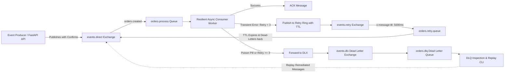

# Resilient Event Streaming Pipeline with Dead Letter Queue (DLQ)

[](https://github.com/PradeepYadav20032006/event-pipeline/actions)


A production-grade, distributed event streaming pipeline built with RabbitMQ, `aio-pika`, and FastAPI. Features **At-Least-Once Delivery**, publisher confirms, a **3-Ring Dead Letter Exchange (DLX)** backoff architecture, and an operational DLQ inspection/replay CLI.

---

## 🏗️ Architecture Overview



---

## ⚡ Core Engineering Highlights

### 1. Zero Message Loss (At-Least-Once Delivery)
- **Publisher Confirms (`publisher_confirms=True`)**: Asynchronously awaits RabbitMQ's basic.ack on ingestion before returning HTTP 202 to client.
- **Message Persistence (`DeliveryMode.PERSISTENT`)**: All messages are written to disk across durable exchanges and queues.
- **Manual Consumer ACKs**: Messages are acknowledged strictly after successful business logic execution.

### 2. 3-Ring Retry & Dead-Letter Architecture
- **Zero-CPU Delay**: Retries rest safely in an unconsumed queue (`orders.retry.queue`) configured with `x-message-ttl: 5000ms`.
- **Automatic Bouncing**: RabbitMQ's Erlang engine natively routes expired retry messages back to `events.direct` without blocking consumer threads.
- **Poison-Pill Quarantine**: Malformed messages or events exceeding `MAX_RETRIES` (3) are safely isolated into `orders.dlq`.

### 3. Production DLQ Operational CLI
The pipeline includes a dedicated operational CLI for on-call engineers:
```bash
# Check queue depths
python -m src.pipeline.dlq_admin status

# Non-destructively inspect quarantined messages & death reasons
python -m src.pipeline.dlq_admin inspect

# Replay quarantined messages back into the main pipeline with cleared retry counters
python -m src.pipeline.dlq_admin replay

# Purge unrecoverable poison pills
python -m src.pipeline.dlq_admin purge
```

### 4. Full Production Observability
- **Prometheus Metrics (`/metrics`)**:
  - `pipeline_events_published_total`: Counter by event type and status.
  - `pipeline_consumer_messages_total`: Counter by outcome (`success`, `retry`, `dlq`).
  - `pipeline_consumer_duration_seconds`: Histogram of processing latencies.
  - `pipeline_http_request_duration_seconds`: HTTP ingress latency metrics.
- **Distributed Tracing**: CloudEvents envelope propagates `event_id` and `correlation_id` across the entire pipeline.

---

## 🚀 Quickstart & Local Setup

### 1. Start RabbitMQ with Docker Compose
```bash
docker compose up -d
```
- AMQP Broker: `localhost:5672`
- Management Web Dashboard: `http://localhost:15672` (User: `pipeline_user`, Password: `pipeline_pass`)

### 2. Run the Event Ingress API
```bash
uvicorn src.pipeline.main:app --host 0.0.0.0 --port 8000 --reload
```

### 3. Ingest an Order Event
```bash
curl -X POST http://localhost:8000/api/v1/orders \
  -H "Content-Type: application/json" \
  -H "X-Correlation-ID: custom-trace-12345" \
  -d '{
    "customer_id": "cust-9982",
    "customer_email": "shopper@example.com",
    "items": [{"item_id": "item-1", "quantity": 1, "price": 49.99}],
    "total_amount": 49.99
  }'
```

---

## 🧪 Automated Testing

Run the full pytest suite:
```bash
pytest -v
```

### Test Suite Structure (15/15 Passing):
- `tests/test_foundation.py` (2 tests): Health probes and robust connection manager lifecycle.
- `tests/test_producer.py` (3 tests): CloudEvents envelope validation, publisher confirms (`publisher_confirms=True`), and HTTP 202 ingress.
- `tests/test_topology.py` (3 tests): Declarations of exchanges, queues, `x-dead-letter-exchange`, and `x-message-ttl: 5000ms`.
- `tests/test_consumer.py` (4 tests): Successful processing, transient retry routing, max retry exhaustion, and immediate poison pill quarantine (`PoisonPillException`).
- `tests/test_dlq_admin.py` (3 tests): Non-destructive DLQ inspection, atomic replay back to main exchange, and queue purging.

```bash
# Execute test suite
pytest -q
# Output: 15 passed in ~1.08s
```

---

## ⚠️ Infrastructure Boundary & Known Limitations

- **Consumer Side-Effects**: While RabbitMQ guarantees at-least-once message delivery, non-transactional downstream side effects (such as sending external webhooks or emails) require an Inbox deduplication pattern on the receiving service.
- **Retry Ring Granularity**: The default retry ring TTL is set to 5000ms; exponential backoff in RabbitMQ without plugins uses stepped discrete queues rather than continuous arbitrary delays.
- **Test Harness vs. Live Broker**: Automated tests run with simulated asynchronous AMQP protocol adapters (`aio-pika` mocks) for zero-dependency CI execution. Full live testing requires running RabbitMQ (configured in `docker-compose.yml`).

---

## 📚 Architectural Decision Records (ADRs) & Runbook

- [ADR 001: 3-Ring DLX & TTL Retry Topology](docs/adr/001-dead-letter-exchange-topology.md)
- [ADR 002: Publisher Confirms & Manual ACKs](docs/adr/002-publisher-confirms-at-least-once.md)
- [3 AM Operational Incident Runbook](docs/runbook-dlq-triage.md)

---

## 📄 License
This project is licensed under the MIT License.
